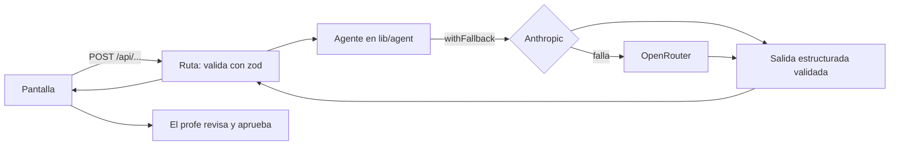

# Tiza.ai

Prácticos y parciales de matemática de bachillerato adaptados a cada estudiante del grupo. El profesor sube el práctico que ya tiene y la IA arma una versión para cada combinación de perfiles del grupo: TDAH, dislexia, TEA, discapacidad motriz (responde con la mirada) y disgrafía (responde dictando). El profesor revisa y aprueba cada versión, los estudiantes la resuelven en la plataforma y el profesor corrige.

Proyecto del equipo para [build 101](https://www.build101.dev/) (FIUM/LATU, Montevideo).

- Contexto del hackathon y reglas del equipo: [`CLAUDE.md`](CLAUDE.md)
- Roles, horarios, idea y pitch: [`docs/`](docs/)
- Cómo se cargan los datos de cada perfil: [`data/profiles/README.md`](data/profiles/README.md)

## Arrancar

```bash
npm install                  # también copia el WASM de MediaPipe a public/mediapipe
cp .env.example .env.local   # completar las claves
npm run dev                  # http://localhost:3000
```

Cuentas de demo (login simulado): profesor `profe` / `demo123`; estudiantes `ana`, `bruno`, `camila`, `facundo`, `belen` con la misma contraseña.

| Variable | Para qué |
|---|---|
| `ANTHROPIC_API_KEY` | La IA (Claude). |
| `OPENROUTER_API_KEY` (u `OPEN_ROUTER_ANTHROPIC_KEY`) | Respaldo: si la API de Anthropic falla, se reintenta por OpenRouter. Sin key de Anthropic, todo va por OpenRouter. `OPENROUTER_MODEL` es opcional. |
| `ELEVENLABS_API_KEY` | Voz rioplatense para «Escuchar». Sin ella se usa la voz del navegador. `ELEVENLABS_VOICE_ID` y `ELEVENLABS_MODEL` son opcionales. |
| `SESSION_SECRET` | Firma de la cookie de sesión. Obligatoria en producción. |
| `NEXT_PUBLIC_USE_MOCK` | Con `false` el front llama a la IA real. Si no está, usa respuestas de ejemplo (sirve para trabajar sin gastar API). |

## Stack

- **Next.js 16** (App Router, Cache Components, Turbopack), **React 19**, **TypeScript**, **Tailwind 4**. Esta versión de Next trae cambios: ante la duda, ver `node_modules/next/dist/docs/`.
- **IA:** API de Claude con `@anthropic-ai/sdk`, modelo `claude-opus-5-5`. Todas las llamadas usan salida estructurada (esquemas zod con `betaZodOutputFormat`) y el respaldo de modelo del lado del servidor (`fallbacks: "default"`).
- **Fórmulas:** KaTeX (`react-markdown` + `remark-math` + `rehype-katex`), además de `mathjs` para el verificador del adaptador.
- **Mirada:** MediaPipe Face Landmarker, 100 % en el navegador (el video no sale de la compu).
- **Voz:** Web Speech API para el dictado y ElevenLabs para leer en voz alta.
- **Datos:** sin base de datos. Grupos, estudiantes, prácticos, respuestas y notas viven en el `localStorage` del navegador (`lib/groups/store.ts`). Para la demo alcanza; en producción iría a una base.

## Cómo está organizada

```
app/
  (teacher)/grupos/…        Mis grupos: estudiantes, nuevo práctico, detalle y aprobación, corrección, resultados
  (teacher)/materia/        Mi materia: temario a partir del programa oficial
  (teacher)/adaptar/        Adaptador del compañero (fuera del menú, accesible por URL)
  estudiante/               Inicio y resolución; el layout monta la mirada y la voz
  ingresar/                 Login de profesor y de estudiante
  api/                      Rutas que llaman a la IA (ver abajo)
components/                 UI por área: assessments, groups, solve, student (gaze, voice), syllabus, results, ui
lib/
  agent/                    Agentes del servidor: prompts, esquemas, cliente de la IA
  adapter/                  Pipeline del adaptador con verificador matemático
  groups/ syllabus/         Stores en localStorage, armado de versiones, chequeo de números
  solve/ speech/ voice/     Pasos al resolver, dictado, lectura en voz alta, comandos de voz
  contract.ts               Contrato front ↔ agentes (tipos de cada request y response)
  profiles.ts supports.ts   Perfiles y apoyos de razonamiento disminuido, como datos
data/profiles/              Datos de cada perfil (lo único que el agente puede aplicar)
scripts/                    Destilado de fuentes de perfiles y tests del adaptador
proxy.ts                    Protege las rutas por rol (antes "middleware")
```

## Flujo

**Profesor**
1. **Mi materia:** sube el PDF del programa oficial. El agente lo divide en unidades, el profe las corrige y confirma. Solo un temario confirmado se usa como contexto.
2. **Mis grupos:** crea grupos, agrega estudiantes con sus perfiles y, en «Datos adicionales», sus gustos y los apoyos de razonamiento disminuido (preguntas guía, recordatorio, ejemplo resuelto, números más simples).
3. **Nuevo práctico:** sube el PDF o fotos, o escribe los ejercicios. El agente los transcribe y el profe revisa la transcripción. Puede dejar menos ítems en una versión.
4. **Generar:** se arma una versión por cada combinación de perfiles y apoyos del grupo (28 estudiantes pueden ser 4 versiones) y se generan en paralelo, con progreso por versión.
5. **Revisar y aprobar:** original y versión lado a lado, con la lista de «qué cambió y por qué» y el chequeo de números. **Sin la aprobación del profe, el estudiante no ve nada.**
6. **Corregir y resultados:** nota por estudiante, corrección por ejercicio con etiquetas de error y un análisis del grupo hecho por la IA.

**Estudiante**
- Ve sus prácticos aprobados. **Nunca ve su perfil** ni que su versión es adaptada.
- Resuelve un ejercicio por pantalla. Según su versión:
  - escribe;
  - dicta (disgrafía), y confirma lo que la IA entendió;
  - elige con la mirada entre dos mitades de pantalla (motriz).
- «Escuchar» lee cada ejercicio en voz alta. Con razonamiento disminuido, además se escuchan por separado la consigna y cada apoyo.
- Con perfil motriz, la cámara se prende y calibra apenas entra, y toda la navegación es de a dos opciones. Con disgrafía, puede navegar con comandos de voz.

## Los agentes por detrás

Cada tarea de IA es un agente chico con una sola responsabilidad: un prompt de sistema fijo, una salida estructurada y validada, y reglas que deciden en el código lo que no le toca decidir al modelo. Todos pasan por `lib/agent/client.ts`.



**Cliente de la IA** (`lib/agent/client.ts`)
- `withFallback` llama a la API de Anthropic y, si falla (429, 5xx, sin conexión), reintenta una vez por OpenRouter con el mismo modelo.
- No reintenta un 404: es un archivo que no existe y cambiar de proveedor no lo arregla.
- Por OpenRouter no viajan los archivos de la Files API: el temario va solo como texto.

| Agente | Ruta | Archivo | Qué hace | Esfuerzo |
|---|---|---|---|---|
| Transcriptor | `/api/assessments/read-pdf` | `exercises.ts` | Lee el PDF o las fotos del práctico y lo pasa a markdown + LaTeX, con una lista de dudas para el profe. | medium |
| Temario | `/api/syllabus/pdf` + `/api/syllabus/units` | `syllabus.ts` | Sube el programa a la Files API y lo divide en unidades, una por sección, sin agregar temas. | medium |
| Adaptador de versiones | `/api/generate` | `generate.ts`, `prompt.ts` | Genera una versión por combinación de perfiles (detalle abajo). | medium |
| Transcripción del dictado | `/api/answers/transcribe` | `transcribe.ts` | Pasa lo que dictó el estudiante a notación, **sin corregirlo**, con una lectura para confirmar de oído y las dudas. | low |
| Analista de resultados | `/api/results/analyze` | `analyze.ts` | Resume las dificultades del grupo a partir de las correcciones. Los estudiantes viajan como E1, E2…, sin nombres ni perfiles. | medium |
| Comandos de voz | `/api/voice/command` | `voiceCommand.ts` | Si lo que dijo el estudiante no coincide con una frase fija, elige uno de los comandos de la pantalla o ninguno. | low |
| Adaptador del compañero | `/api/adapt` | `lib/adapter/` | Pipeline con verificador matemático (detalle abajo). | low/medium |

### Adaptador de versiones (`/api/generate`)

Recibe por versión el original, la combinación de perfiles, los gustos, los apoyos, los ejercicios que quedan y el temario confirmado. Nunca recibe nombres de estudiantes.

1. **Lo que decide el código, antes del modelo:**
   - **Datos de perfil:** solo se cargan los perfiles que tienen datos en `data/profiles/<perfil>.md`.
   - **Perfil sin datos:** no se adapta, y se agrega el aviso «Sin adaptaciones para TDAH». Así la IA no inventa pedagogía.
   - **Menos ítems:** se recortan los ejercicios elegidos (`keepExercises`). El modelo nunca ve los que quedaron afuera.
   - **Canal de respuesta:** el perfil motriz pasa a opción múltiple y el de disgrafía a respuestas habladas, aunque el perfil no tenga datos. Es una necesidad del canal, no una adaptación pedagógica.
   - **Sin nada que adaptar:** si no hay nada para adaptar ni gustos, vuelve el original tal cual, sin llamar a la IA.
2. **El prompt** (`prompt.ts`) tiene un sistema fijo, que se cachea, con estas reglas:
   - aplicar **solo** lo que dicen los datos del perfil;
   - no cambiar la matemática;
   - respetar el temario;
   - formato estricto: un ejercicio por línea que empieza con «1)», LaTeX y tablas solo si el original las trae;
   - citar la fuente de cada cambio en «qué cambió y por qué».

   Además tiene secciones para:
   - **gustos:** solo cambia el contexto de los problemas con texto;
   - **apoyos de razonamiento disminuido:** la única forma permitida de bajar la dificultad;
   - **mirada:** 3 preguntas de 2 opciones, con gráficas cuando el original pide graficar;
   - **dictado:** 3 ejercicios, y nada que haya que dibujar.
3. **La salida** se valida contra el esquema. Para la mirada se usa streaming (pueden ser respuestas largas) y se controla que cada pregunta tenga exactamente 2 opciones y la respuesta entre ellas.
4. **El chequeo de números** (`lib/groups/numberCheck.ts`) corre sin IA en la pantalla de aprobación: cada número del ejercicio original tiene que seguir en el mismo ejercicio de la versión. Si algo cambió, el profe tiene que confirmar que lo revisó antes de aprobar.

### Adaptador del compañero (`/api/adapt`, pantalla `/adaptar`)

Pipeline en `lib/adapter/adapt-pipeline.ts` que manda el progreso por streaming (NDJSON):
1. Extrae los ejercicios del PDF o las fotos y reemplaza cada fórmula por un marcador con sus versiones en mathjs y LaTeX.
2. Modela cada problema con texto de forma independiente.
3. Genera en paralelo los formatos lectura fácil, dislexia, lector de pantalla y razonamiento disminuido.
4. **Verifica cada ejercicio con código:**
   - no faltan ni sobran números ni marcadores;
   - las relaciones del enunciado no cambiaron;
   - en los problemas, compara la ecuación del original con la de la versión.

   Lo que falla se reintenta una vez.
5. Arma la clave de respuestas sin IA.

Sus reglas están en `lib/adapter/adapt-prompts.ts` y sus tests corren con `npm run test:adapter`. En Mis grupos se reusan sus apoyos de razonamiento disminuido, sus límites de subida y su voz.

### Datos de los perfiles

El agente adapta usando **solo** lo que dice `data/profiles/<perfil>.md`. Las fuentes (guías, papers) se dejan en `data/profiles/<perfil>/sources/`. `npm run profiles:distill` escribe un borrador `<perfil>.draft.md` con cada adaptación, su fuente, página y cita. El equipo lo revisa y lo aprueba copiándolo al `.md`.

Hoy hay borradores para TDAH, TEA y dislexia, y los `.md` aprobados todavía son plantillas: hasta que se aprueben, esas versiones salen sin adaptar y con el aviso.

### Voz y mirada

- **Leer en voz alta** (`lib/speech/voice.ts`): pide el audio a `/api/tts`, que usa ElevenLabs con la voz rioplatense y caché. Si falla, usa la voz del navegador. `lib/speech/latexSpeech.ts` pasa las fórmulas a palabras («x al cuadrado menos 4 sobre x menos 2»).
- **Dictado** (`lib/speech/useDictation.ts`): Web Speech API en es-UY, con un solo reconocimiento a la vez.
- **Mirada** (`components/student/gaze/`): los rasgos de los ojos se calibran con 3 puntos (izquierda, derecha y centro). Elegir es mirar una mitad de la pantalla hasta que se llena el círculo. Hay un modo práctica con mouse o flechas.

## Aprobación humana y privacidad

- Ninguna versión llega a un estudiante sin la aprobación del profe. Editarla a mano obliga a aprobarla de nuevo.
- A la IA no le llegan nombres de estudiantes: solo ejercicios, perfiles, gustos y apoyos. En el análisis de resultados, los estudiantes van como seudónimos.
- El estudiante nunca ve su perfil.
- Las respuestas dictadas se transcriben sin corregir y el estudiante las confirma antes de guardarlas.

## Scripts

| Comando | Qué hace |
|---|---|
| `npm run dev` | Server de desarrollo |
| `npm run build` / `npm start` | Build y server de producción |
| `npm run lint` | ESLint (antes de pushear: `npx tsc --noEmit && npm run lint`) |
| `npm run test:adapter` | Tests del adaptador: equivalencias, chequeos estáticos, ajustes, accesibilidad y separación de ejercicios |
| `npm run profiles:distill -- <perfil>` | Borrador de adaptaciones a partir de las fuentes del perfil |
